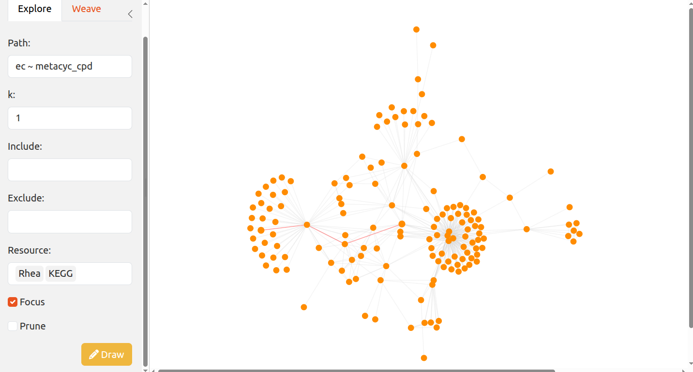
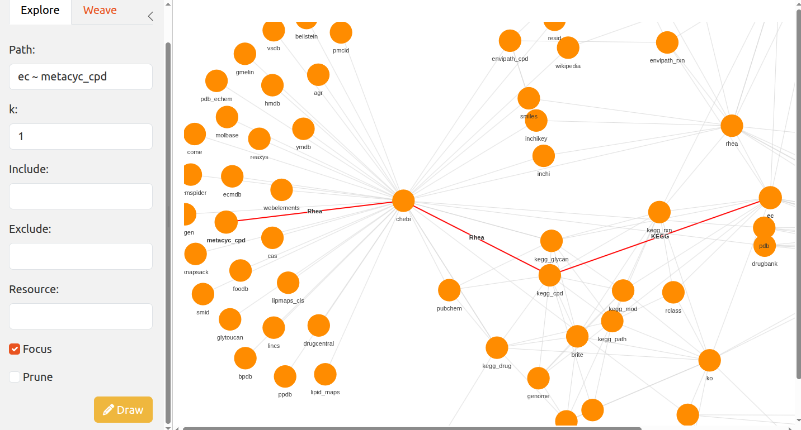
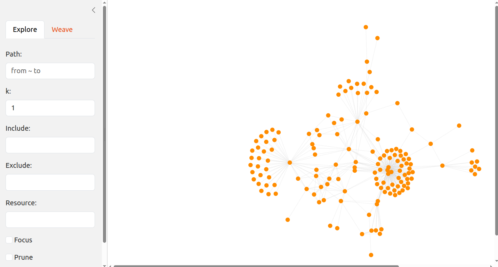

# ariadneApp: interactively explore the ariadne resource graph

## Introduction

ariadneApp is a web app version of the ariadne package designed to
interactively weave resources across the ariadne graph.

## Tutorial

### Installation

### Example

The app can be launched with
[`shinePath()`](https://minotau-r.github.io/ariadneApp/reference/shinePath.md).

\
`# Import ariadneApp`\
[`library`](https://rdrr.io/r/base/library.html)`(`[`ariadneApp`](https://codeberg.org/Minotau-R/ariadneApp)`)`\
\
`# Launch ariadneApp`\
`if`` ``(`[`interactive`](https://rdrr.io/r/base/interactive.html)`(``)``)`` ``{`\
`    `[`shinePath`](https://minotau-r.github.io/ariadneApp/reference/shinePath.md)`(``)`\
`}`

By zooming in, it is possible to focus on specific regions of the graph.
With a long press, you can select nodes to link. Single click on empty
areas to remove the selection.

Selecting `resources` will subset the graph to the chosen ones.

`Prune`, `Focus`.

## Resources

### Citation

\
`## Citation info`\
[`citation`](https://rdrr.io/r/utils/citation.html)`(``"ariadneApp"``)`\
`#> Warning in citation("ariadneApp"): could not determine year for 'ariadneApp'`\
`#> from package DESCRIPTION file`\
`#> To cite package 'ariadneApp' in publications use:`\
`#> `\
`#>   Benedetti G, Bastiaanssen T, Lahti L (????). _ariadneApp: ariadneApp:`\
`#>   interactively explore the ariadne resource graph_. R package version`\
`#>   0.0.5, <https://codeberg.org/Minotau-R/ariadneApp>.`\
`#> `\
`#> A BibTeX entry for LaTeX users is`\
`#> `\
`#>   @Manual{,`\
`#>     title = {ariadneApp: ariadneApp: interactively explore the ariadne resource graph},`\
`#>     author = {Giulio Benedetti and Thomaz Bastiaanssen and Leo Lahti},`\
`#>     note = {R package version 0.0.5},`\
`#>     url = {https://codeberg.org/Minotau-R/ariadneApp},`\
`#>   }`

### Background

ariadneApp originates from the joint effort of the R/Bioconductor
community. It is mainly based on the following software:

- [R](https://www.r-project.org/), statistical programming language (R
  Core Team 2026)
- [ariadne](https://codeberg.org/Minotau-R/ariadne), framework for
  multi-modal integration of biological data (Benedetti et al. 2026)
- [visNetwork](https://cran.r-project.org/package=visNetwork),
  interactive network visualisation (Almende B.V. and Contributors and
  Thieurmel 2025)
- [shiny](https://cran.r-project.org/package=shiny), web app development
  in R (Chang et al. 2026)

### Help

You can reach us by one of the communication channels listed
[here](https://microbiome.github.io/OMA/docs/devel/pages/support.html).
We are happy to receive questions, suggestions as well as contributions.
For the last point, check the [contributor
guidelines](https://microbiome.github.io/mia/CONTRIBUTING.html).

## Reproducibility

R session information:

    #> R version 4.6.1 (2026-06-24)
    #> Platform: x86_64-pc-linux-gnu
    #> Running under: Ubuntu 24.04.5 LTS
    #> 
    #> Matrix products: default
    #> BLAS:   /usr/lib/x86_64-linux-gnu/openblas-pthread/libblas.so.3 
    #> LAPACK: /usr/lib/x86_64-linux-gnu/openblas-pthread/libopenblasp-r0.3.26.so;  LAPACK version 3.12.0
    #> 
    #> locale:
    #>  [1] LC_CTYPE=en_US.UTF-8       LC_NUMERIC=C               LC_TIME=en_US.UTF-8        LC_COLLATE=en_US.UTF-8    
    #>  [5] LC_MONETARY=en_US.UTF-8    LC_MESSAGES=en_US.UTF-8    LC_PAPER=en_US.UTF-8       LC_NAME=C                 
    #>  [9] LC_ADDRESS=C               LC_TELEPHONE=C             LC_MEASUREMENT=en_US.UTF-8 LC_IDENTIFICATION=C       
    #> 
    #> time zone: UTC
    #> tzcode source: system (glibc)
    #> 
    #> attached base packages:
    #> [1] stats     graphics  grDevices utils     datasets  methods   base     
    #> 
    #> other attached packages:
    #> [1] ariadneApp_0.0.5 visNetwork_2.1.4 shiny_1.14.0     igraph_2.3.4     bslib_0.12.0     BiocStyle_2.41.0
    #> 
    #> loaded via a namespace (and not attached):
    #>   [1] DBI_1.3.0                   gridExtra_2.3.1             enviPathR_1.0.2             httr2_1.3.0                
    #>   [5] rlang_1.3.0                 magrittr_2.0.5              otel_0.2.0                  matrixStats_1.5.0          
    #>   [9] compiler_4.6.1              RSQLite_3.53.3              png_0.1-9                   systemfonts_1.3.2          
    #>  [13] vctrs_0.7.3                 stringr_1.6.0               pkgconfig_2.0.3             crayon_1.5.3               
    #>  [17] fastmap_1.2.0               dbplyr_2.6.0                XVector_0.53.0              ggraph_2.2.2               
    #>  [21] promises_1.5.0              rmarkdown_2.32              tzdb_0.5.0                  ragg_1.5.2                 
    #>  [25] purrr_1.2.2                 bit_4.6.0                   xfun_0.62                   cachem_1.1.0               
    #>  [29] jsonlite_2.0.0              progress_1.2.3              blob_1.3.0                  later_1.4.8                
    #>  [33] DelayedArray_0.39.8         BiocParallel_1.47.0         tweenr_2.0.3                prettyunits_1.2.0          
    #>  [37] parallel_4.6.1              R6_2.6.1                    stringi_1.8.9               RColorBrewer_1.1-3         
    #>  [41] GenomicRanges_1.65.4        jquerylib_0.1.4             Rcpp_1.1.2                  Seqinfo_1.3.2              
    #>  [45] bookdown_0.48               assertthat_0.2.1            SummarizedExperiment_1.43.0 knitr_1.52                 
    #>  [49] readr_2.2.0                 IRanges_2.47.5              rentrez_1.2.4               rotl_3.1.1                 
    #>  [53] httpuv_1.6.17               Matrix_1.7-6                tidyselect_1.2.1            viridis_0.6.5              
    #>  [57] abind_1.4-8                 yaml_2.3.12                 codetools_0.2-20            curl_8.1.0                 
    #>  [61] lattice_0.23-1              tibble_3.3.1                Biobase_2.73.2              withr_3.0.3                
    #>  [65] KEGGREST_1.53.6             S7_0.2.2                    evaluate_1.0.5              desc_1.4.3                 
    #>  [69] polyclip_1.10-7             BiocFileCache_3.3.2         Biostrings_2.81.9           pillar_1.11.1              
    #>  [73] BiocManager_1.30.27         filelock_1.0.3              MatrixGenerics_1.25.0       stats4_4.6.1               
    #>  [77] shinyjs_2.1.1               generics_0.1.4              hms_1.1.4                   S4Vectors_0.51.10          
    #>  [81] ggplot2_4.0.3               scales_1.4.0                xtable_1.8-8                rncl_0.8.10                
    #>  [85] glue_1.8.1                  tools_4.6.1                 data.table_1.18.6.1         forcats_1.0.1              
    #>  [89] XML_3.99-0.25               graphlayouts_1.2.5          fs_2.1.0                    multifactor_0.1.3          
    #>  [93] tidygraph_1.3.1             grid_4.6.1                  ape_5.8-1                   tidyr_1.3.2                
    #>  [97] nlme_3.1-171                ggforce_0.5.0               cli_3.6.6                   textshaping_1.0.5          
    #> [101] viridisLite_0.4.3           S4Arrays_1.13.2             arrow_26.0.0                dplyr_1.2.1                
    #> [105] gtable_0.3.6                sass_0.4.10                 digest_0.6.39               BiocGenerics_0.59.12       
    #> [109] ggrepel_0.9.8               SparseArray_1.13.4          waiter_0.2.5.1              htmlwidgets_1.6.4          
    #> [113] farver_2.1.2                memoise_2.0.1               htmltools_0.5.9             pkgdown_2.2.1              
    #> [117] lifecycle_1.0.5             httr_1.4.9                  mime_0.13                   ariadne_0.2.12             
    #> [121] bit64_4.8.6                 MASS_7.3-66

## References

Almende B.V. and Contributors, and Benoit Thieurmel. 2025. *visNetwork:
Network Visualization Using ’Vis.js’ Library*.
<https://doi.org/10.32614/CRAN.package.visNetwork>.

Benedetti, Giulio, Thomaz Bastiaanssen, and Leo Lahti. 2026. *Ariadne:
Assembling Relational Information across the Database NEtwork*.
<https://github.com/Minotau-R/ariadne>.

Chang, Winston, Joe Cheng, JJ Allaire, et al. 2026. *Shiny: Web
Application Framework for r*.
<https://doi.org/10.32614/CRAN.package.shiny>.

R Core Team. 2026. *R: A Language and Environment for Statistical
Computing*. R Foundation for Statistical Computing.
<https://doi.org/10.32614/R.manuals>.
